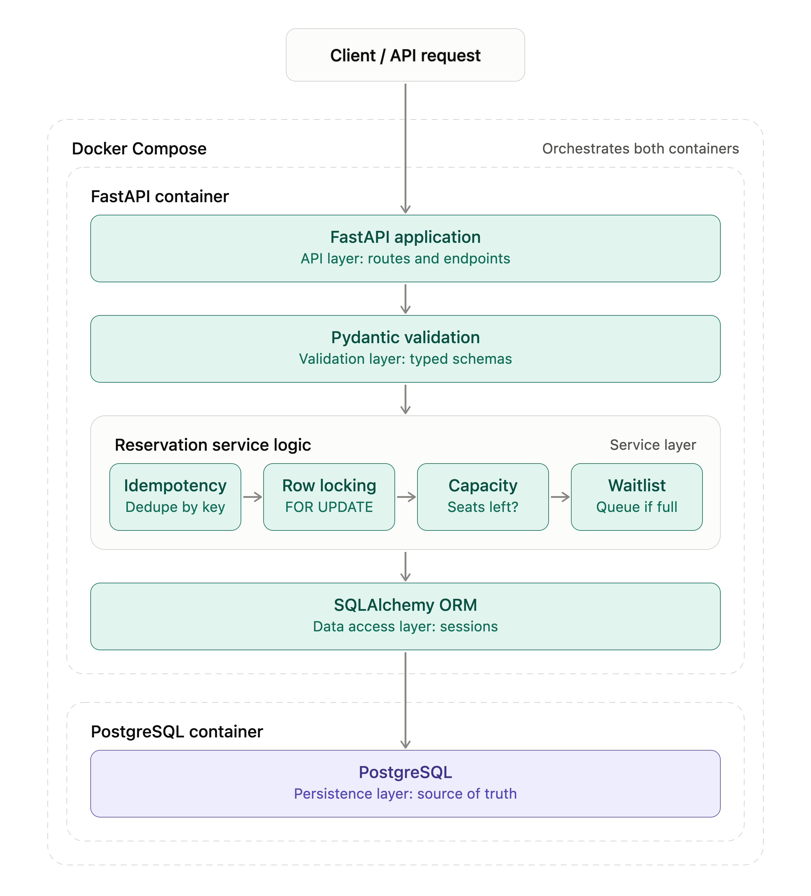
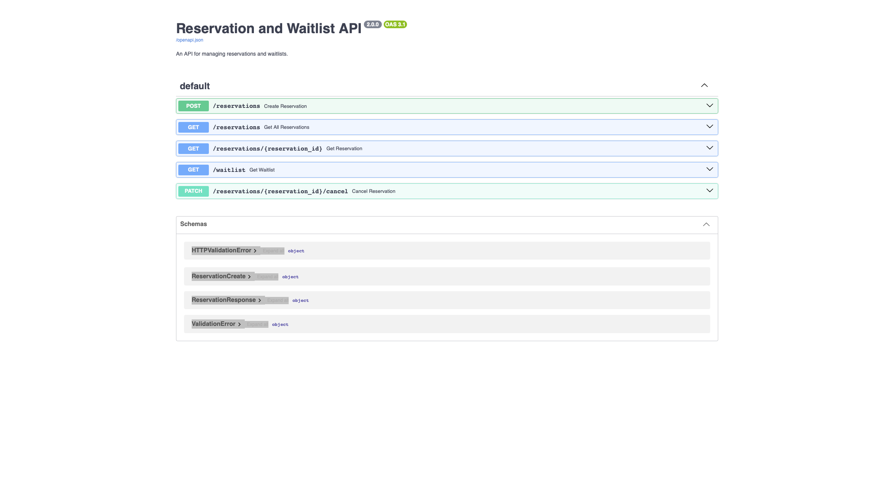
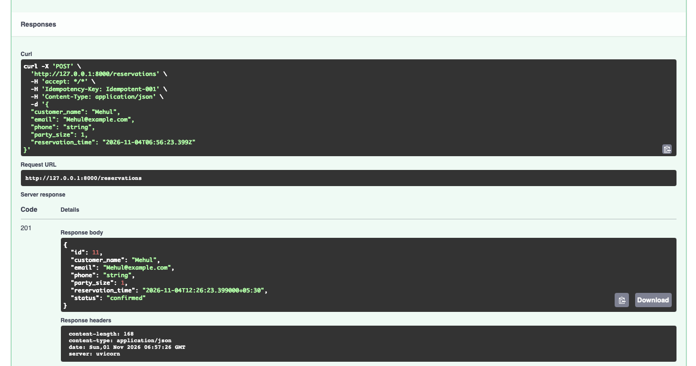
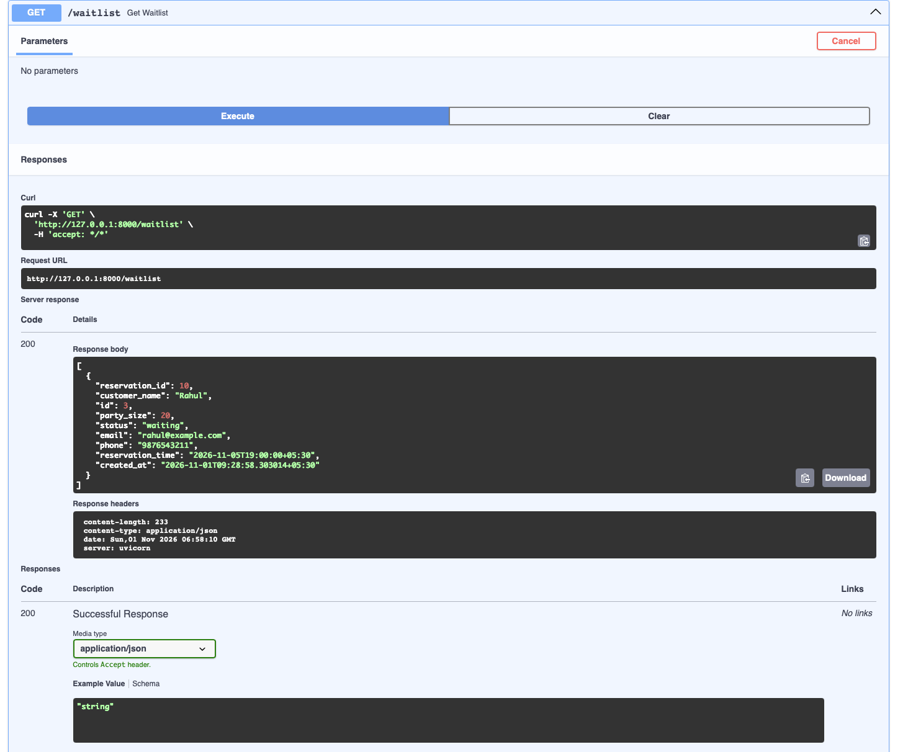
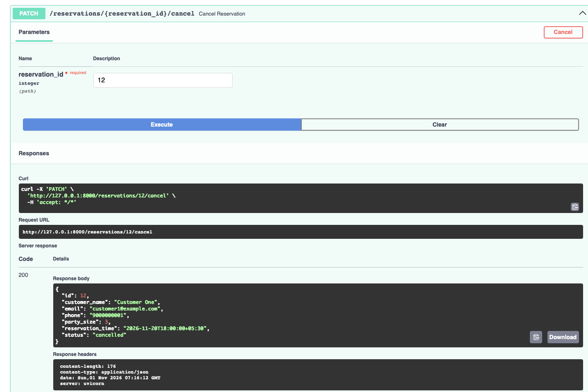
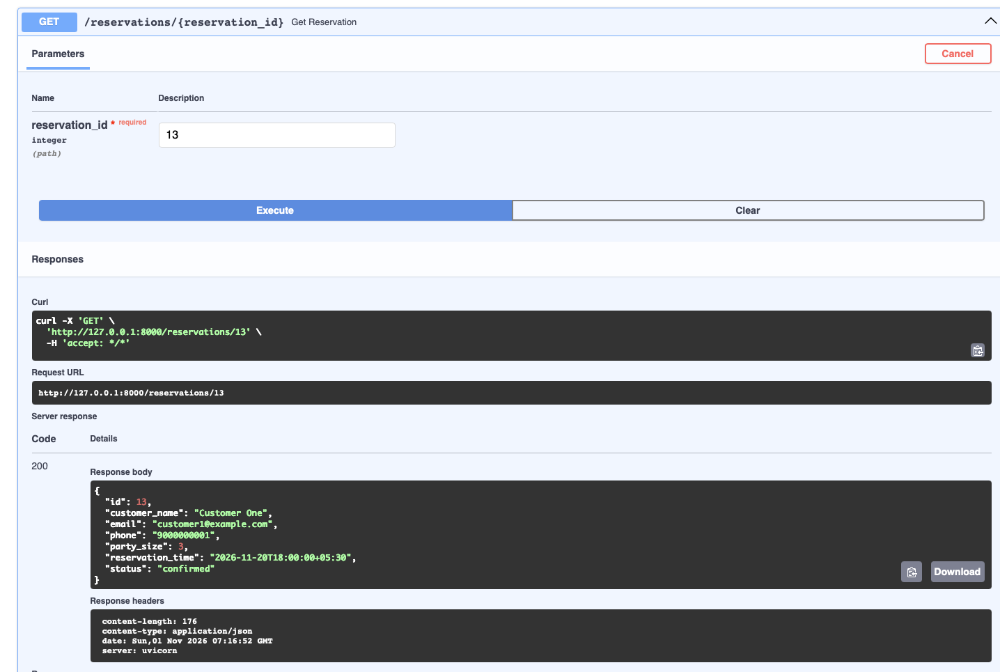
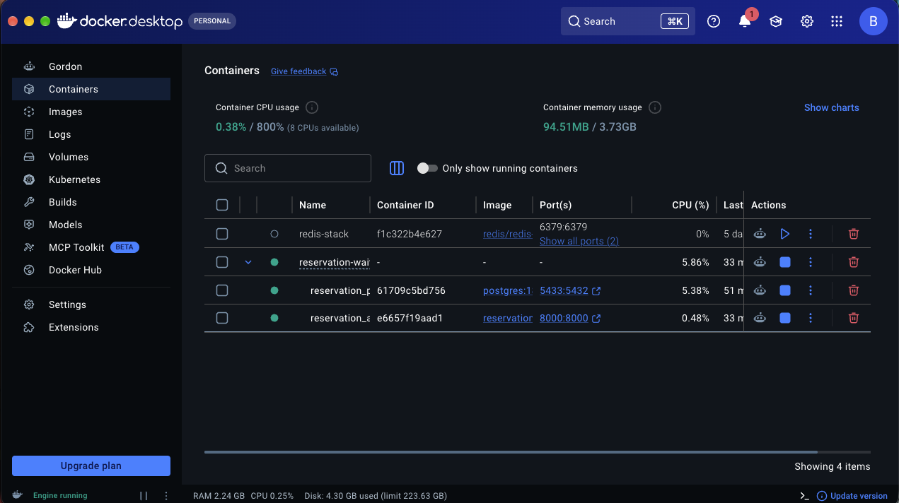
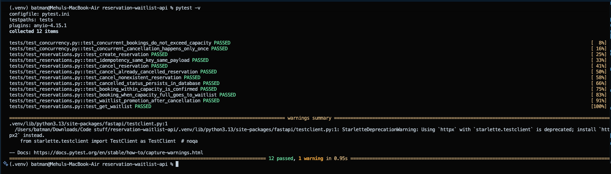

# Reservation & Waitlist API

A backend reservation management system built with **FastAPI, PostgreSQL, SQLAlchemy, and Docker**. It manages reservation capacity, prevents overbooking during concurrent requests, and automatically promotes waiting customers when seats become available.

## Overview

The Reservation & Waitlist API handles reservations for time-based slots with a fixed capacity of 5 people per slot.

When a customer requests a reservation:
- If sufficient capacity is available, the reservation is confirmed.
- If capacity is insufficient, the reservation is added to the waitlist.
- When a confirmed reservation is cancelled, the system checks the waitlist and promotes the oldest waiting group if the entire group fits.

The project focuses on backend engineering concepts such as database transactions, concurrency control, idempotency, and data consistency.

## Key Features

- **Capacity Management:** Prevents reservations from exceeding the configured slot capacity.
- **Concurrency Control:** Uses PostgreSQL row-level locking (`SELECT FOR UPDATE`) to coordinate simultaneous booking and cancellation operations.
- **Idempotent Booking:** Uses an `Idempotency-Key` header and request hashing to prevent duplicate reservations from repeated requests.
- **FIFO Waitlist:** Maintains waiting order and promotes the oldest eligible group.
- **Atomic Database Operations:** Keeps related reservation, waitlist, and idempotency changes within database transactions.
- **Reservation Cancellation:** Supports cancellation and automatic waitlist promotion.
- **Pagination:** Supports `skip` and `limit` parameters when listing reservations.
- **Input Validation:** Uses Pydantic to validate customer details, email, party size, and reservation data.
- **Database Migrations:** Uses Alembic to manage schema changes.
- **Containerization:** Runs the API and PostgreSQL using Docker Compose.
- **Automated Testing:** Includes functional tests and PostgreSQL concurrency tests.

## System Architecture

The application follows a layered backend architecture:

- **API Layer:** FastAPI handles HTTP requests and routes.
- **Validation Layer:** Pydantic validates incoming request data.
- **Service Logic:** Handles idempotency, database row locking, capacity checks, reservations, cancellations, and FIFO waitlist promotion.
- **Data Access Layer:** SQLAlchemy ORM manages database sessions and queries.
- **Database Layer:** PostgreSQL stores reservations, waitlist entries, slots, and idempotency records.
- **Infrastructure:** Docker Compose orchestrates the API and PostgreSQL containers.




## Tech Stack

| Category | Technology |
|---|---|
| Language | Python |
| Backend Framework | FastAPI |
| Database | PostgreSQL |
| ORM | SQLAlchemy |
| Data Validation | Pydantic |
| Database Migrations | Alembic |
| Testing | Pytest, HTTPX |
| Containerization | Docker, Docker Compose |
| API Documentation | Swagger UI |


## Core Engineering Concepts

### 1. Preventing Overbooking

Multiple customers may attempt to book the same slot simultaneously.

The application locks the corresponding reservation slot using PostgreSQL row-level locking before checking available capacity.

This coordinates competing booking operations so they do not independently make decisions using stale capacity information.

### 2. Idempotency

Every booking request must include an `Idempotency-Key` header.

The application:
1. Generates a canonical representation of the request.
2. Calculates a SHA-256 request hash.
3. Checks whether the key has already been used.
4. Returns the original reservation for an identical retry.
5. Rejects reuse of the same key with different request data.

### 3. FIFO Waitlist Promotion

When a confirmed reservation is cancelled:
1. The system locks the relevant reservation slot.
2. It recalculates available capacity.
3. It selects the oldest waiting entry.
4. It promotes the group only if the entire party fits.
5. It continues checking the queue while eligible groups can be promoted.

Groups are never split, and the oldest group is not skipped when it cannot fit.

## API Endpoints

Base URL: `http://localhost:8000`

| Method | Endpoint | Description |
|---|---|---|
| POST | `/reservations` | Create a reservation |
| GET | `/reservations` | List reservations |
| GET | `/reservations/{reservation_id}` | Retrieve a reservation |
| GET | `/waitlist` | Retrieve waiting entries |
| PATCH | `/reservations/{reservation_id}/cancel` | Cancel a reservation |

### Create Reservation

`POST /reservations`

Required header:

```http
Idempotency-Key: unique-request-key
```

Request body:

```json
{
  "customer_name": "Rahul",
  "email": "rahul@example.com",
  "phone": "9876543210",
  "party_size": 2,
  "reservation_time": "2027-01-15T18:00:00+05:30"
}
```

Example response:

```json
{
  "id": 1,
  "customer_name": "Rahul",
  "email": "rahul@example.com",
  "phone": "9876543210",
  "party_size": 2,
  "reservation_time": "2027-01-15T12:30:00Z",
  "status": "confirmed"
}
```

Possible reservation statuses:

- `confirmed`
- `waitlisted`
- `cancelled`

### List Reservations

`GET /reservations?skip=0&limit=10`

Supports pagination. The default limit is 10 and the maximum is 100.

### Get Reservation

`GET /reservations/1`

Returns the reservation with the specified ID.

### Get Waitlist

`GET /waitlist`

Returns entries whose waitlist status is currently `waiting`, ordered by creation time.

### Cancel Reservation

`PATCH /reservations/1/cancel`

Cancels an active reservation and attempts to promote eligible waiting groups.

## Getting Started

### Prerequisites

- Python 3.12+
- Git
- PostgreSQL (for PostgreSQL-specific concurrency testing)
- Docker Desktop and Docker Compose (for containerized execution)

### 1. Clone the Repository

```bash
git clone https://github.com/BrewAndCode/reservation-waitlist-api.git
cd reservation-waitlist-api
```

### 2. Create a Virtual Environment

```bash
python -m venv .venv
source .venv/bin/activate
```

### 3. Install Dependencies

```bash
pip install -r requirements.txt
```

### 4. Configure Environment Variables

Create your local environment file:

```bash
cp .env.example .env
```

The example file uses SQLite for the basic local application setup.

For PostgreSQL-based concurrency testing, configure `TEST_DATABASE_URL` with a dedicated PostgreSQL test database. Create that database before running the concurrency tests.

Never commit real passwords or credentials.

### 5. Run Database Migrations

```bash
alembic upgrade head
```

### 6. Start the API

```bash
uvicorn app.main:app --reload
```

The API will be available at:

`http://localhost:8000`

Interactive Swagger documentation:

`http://localhost:8000/docs`

## Run with Docker

The project includes a Dockerfile and Docker Compose configuration for running the API with PostgreSQL.

Configure the required root `.env` and `.env.docker` files using your own local credentials. The Docker API database URL must use the Compose database service hostname `db`.

Start the services:

```bash
docker compose up --build
```

The API will be available at:

`http://localhost:8000`

Stop the services without deleting the database volume:

```bash
docker compose down
```

## Running Tests

Run the functional test suite:

```bash
pytest tests/test_reservations.py -v
```

Run the PostgreSQL concurrency tests:

```bash
pytest tests/test_concurrency.py -v
```

The concurrency tests require a dedicated PostgreSQL database configured through `TEST_DATABASE_URL`.

Run the complete test suite:

```bash
pytest -v
```

The project includes tests for reservation creation, validation, cancellation, idempotency, capacity management, waitlist promotion, simultaneous bookings, and simultaneous cancellation attempts.

## Project Structure

```text
reservation-waitlist-api/
│
├── app/
│   ├── __init__.py
│   ├── database.py
│   ├── main.py
│   ├── models.py
│   └── schemas.py
│
├── migrations/
│   ├── versions/
│   └── env.py
│
├── tests/
│   ├── test_reservations.py
│   └── test_concurrency.py
│
├── .dockerignore
├── .env.example
├── .gitignore
├── Dockerfile
├── docker-compose.yml
├── alembic.ini
├── pytest.ini
├── requirements.txt
└── README.md
```

## Screenshots

### 1. API Documentation
Overview of all available REST API endpoints.



### 2. Reservation Creation
Successful reservation creation using an idempotency key.



### 3. Waitlist Management
Example of a reservation entering the waitlist when capacity is insufficient.



### 4. Reservation Cancellation
Successful cancellation of a confirmed reservation.



### 5. Automatic Waitlist Promotion
Verification that a waiting reservation is automatically promoted after cancellation.



### 6. Docker Containers
Reservation API and PostgreSQL running through Docker Compose.



### 7. Automated Test Results
Functional and concurrency test suite execution.



## Future Improvements

- API authentication and authorization.
- Configurable slot capacity.
- Rate limiting.
- CI/CD integration.
- Production deployment and monitoring.

## Author

**BrewAndCode**

GitHub: https://github.com/BrewAndCode

---

If you find this project useful, consider giving the repository a star.